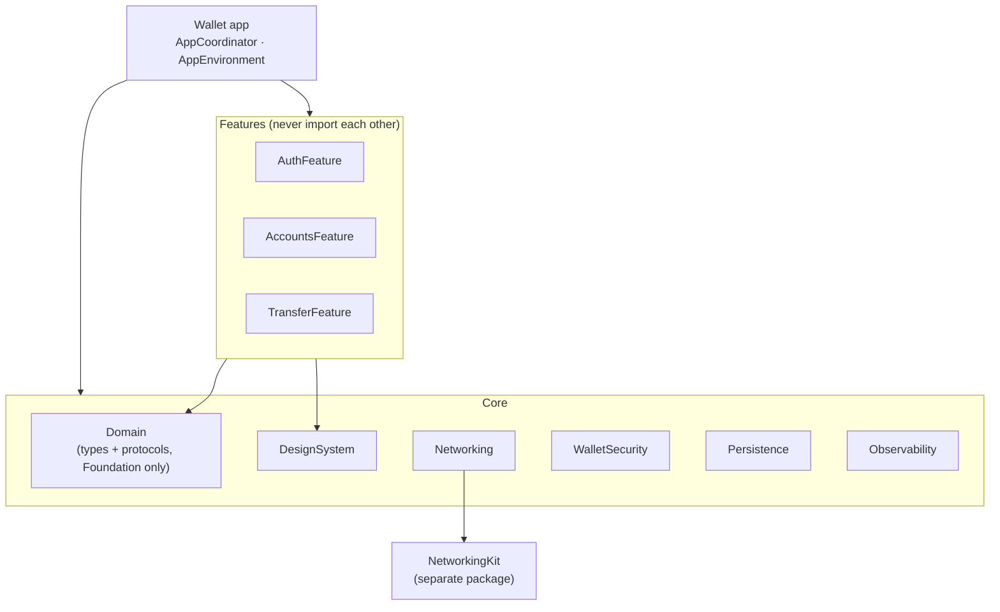
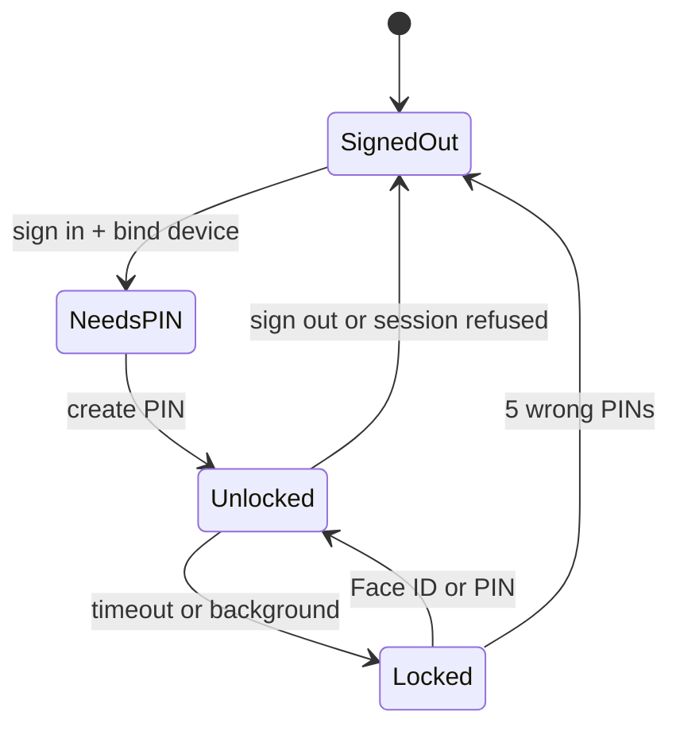
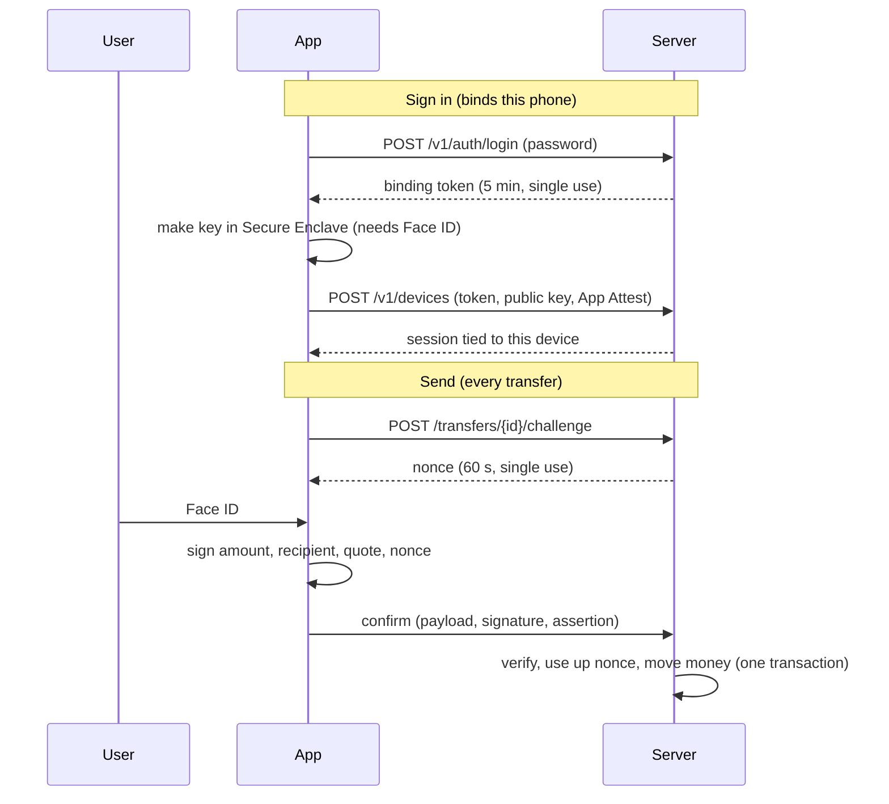

@@ -0,0 +1,298 @@
# Wallet

A multi-currency wallet for iOS with a Wise-style send flow and bank-grade security. It's a portfolio project: the money is fake and the backend is a local sandbox, but the security controls are real. Transfers are signed in the Secure Enclave, App Attest is verified on the server, and the connection is pinned.

**Swift 6 · SwiftUI · strict concurrency · modular Swift package · CryptoKit and Secure Enclave · App Attest · SwiftData · Vapor backend in Swift · Swift Testing and XCUITest · GitHub Actions**

> **Status:** Phases 1–7 of 10 are done. Still to come: passport reading over NFC, production hardening with TestFlight, and a demo video.
> To run it, see [Running it](#running-it), or the full [development guide](docs/DEVELOPMENT.md).

---

## The problem

A money app has to handle what most apps can ignore:

- **Money must be exact.** Every currency has its own decimals (JPY 0, SGD 2, KWD 3), and floating point can't represent 0.1.
- **A transfer must happen exactly once,** even if the user double-taps, the network times out, or the app is killed halfway.
- **A password isn't enough.** A stolen password, a stolen session token or a modified app must not be able to move money.
- **Nothing sensitive should be left on the phone,** in logs, or in the app switcher.

The rest of this README shows how each of these is handled, and why it was done that way instead of the usual alternative.

---

## Architecture



### Modular Swift package, with boundaries the compiler enforces
**Decision:** all the code lives in one local Swift package, `WalletKit`, with a target per module. `Package.swift` declares what each module may import. Features never import each other, and never import Networking, Persistence or WalletSecurity: they depend only on protocols in `Domain`. ([ADR-004](docs/adr/004-local-spm-modules.md))

**Why:** in a single app target, any file can import anything. A layered design then depends on everyone remembering the rules, and one stray import quietly couples Transfer to Auth. With targets, a forbidden import **doesn't compile**. A CI script checks the same rules again. Modules can also be built and tested on their own with `swift test`, with no simulator.

**Rejected:**
- **Folders in one target:** the boundaries are only a convention.
- **A separate package per module:** 12 manifests to wire up, with no extra enforcement.

### A plain Xcode project, with Tuist left for team scale
**Decision:** the Xcode project holds only the thin app target; everything else is in the package. ([ADR-013](docs/adr/013-plain-xcode-and-local-spm.md))

**Why:** Tuist and XcodeGen solve merge conflicts in the project file and slow builds for big teams. For one developer they add a tool and a generation step, while SwiftPM already enforces the module graph.

**At scale:** Tuist pays off once there are several teams, several app targets, or slow CI builds that need binary caching.

### Manual dependency injection, with no framework and no singletons
**Decision:** `AppEnvironment` is the only place that builds concrete types. Everything else receives protocols through its initialiser. ([ADR-005](docs/adr/005-manual-constructor-injection.md))

**Why:**
- A missing dependency is a **compile error**, not a crash at runtime.
- Tests and SwiftUI previews pass fakes the same way the app passes real objects.
- A singleton like `SessionStore.shared` would let any feature reach security code around the module rules, and would share state between tests.

**Rejected:** swift-dependencies and Factory. They add a third-party dependency for about a dozen objects, and they work like a service locator.

### Our own networking layer instead of Alamofire
**Decision:** `NetworkingKit` is a separate package of about 300 lines over `URLSession`. It has an interceptor chain for auth, idempotency keys, retry with backoff, request IDs and TLS pinning. It imports Foundation only. ([ADR-012](docs/adr/012-custom-urlsession-client.md))

**Why:**
- The most security-sensitive code path shouldn't depend on a third-party library.
- Owning it means I can explain exactly how retries reuse the same idempotency key.
- As a separate package, "generic, knows nothing about wallets" is enforced by the compiler, not by convention.

### Swift 6 strict concurrency in every module
**Decision:** every target compiles in Swift 6 language mode. UI types are `@MainActor`. Shared mutable state (`SessionStore`, `TransferOutbox`) lives in actors. ([ADR-014](docs/adr/014-swift-6-strict-concurrency.md))

**Why:** data races in session or transfer code are exactly the bugs that are rare, hard to reproduce and expensive. The compiler now catches them. Keeping some modules on Swift 5 would leave the riskiest code the least checked.

---

## Navigation



### MVVM with one router per flow
**Decision:**
- Each feature has a `Route` enum, an `@Observable` router that owns a `NavigationPath`, and one public `FlowView`.
- View models hold one `State` value and expose async methods.
- Views render state and never navigate except through the router.

**Why:** navigation logic in views is hard to test and gets scattered. With a router, a test can check "tapping Send pushes the status screen" without any UI. TCA was considered and rejected: it's a large dependency and a whole paradigm for a team to learn, while `@Observable` plus a router covers what this app needs.

### Features talk through output closures
**Decision:** a feature never opens another feature's screen. Accounts calls `onSendMoney(accountID)`, and `AppCoordinator` decides what happens.

**Why:** this keeps features independent. They can be reordered, tested and built on their own, and the app's overall flow lives in one place.

### The root screen is swapped, never pushed
**Decision:** `AppCoordinator` shows exactly one root for the current `SessionState`: signed out, create PIN, locked or unlocked. ([ADR-020](docs/adr/020-root-swap-by-session-state.md))

**Why:** if the lock screen were pushed onto a stack, swipe-back could reveal balances. If it were a full-screen cover, the balances would still be loaded underneath, and safety would depend on the cover never being dismissed by mistake. Swapping the root means the screens behind the lock **don't exist**.

---

## Money and transfers

### Money is `Decimal`, with integer minor units at the API
`Money` pairs a `Decimal` amount with a `Currency`. Arithmetic only works between equal currencies, and rounding is banker's rounding to each currency's minor units. The API carries `amountMinor: Int64`, never a float. A contract test checks that the app and the backend agree on the currency table. The app also re-checks the server's quote maths (fee, rate, rounding, expiry) before showing it.

### The transfer state machine is a pure function
`next(state, event) -> State` lives in Domain and is tested for every valid and invalid pair. The flow runs Draft → Quoted → Authorised → Submitted → Processing → Completed or Failed. An expired quote is re-quoted **visibly**; the rate never changes silently.

### An outbox makes transfers survive crashes
**Decision:** each transfer step is saved to a SwiftData outbox **before** the network call. On relaunch, the outbox resumes every unfinished transfer. ([ADR-009](docs/adr/009-swiftdata-outbox-complete-protection.md), [ADR-022](docs/adr/022-unsigned-confirm-and-outbox-recovery.md))

**Why:** a timeout doesn't say whether the server did the work, and treating it as a failure invites the user to pay twice. So:
- **A timeout is never a failure.** The app asks the server for the transfer's status instead.
- **Every call is safe to repeat.** It's keyed on the transfer's ID with an `Idempotency-Key`, and the server compares request bodies as well as keys.
- **The outbox file is protected.** It uses `.complete` file protection (unreadable while the phone is locked), is excluded from backups, and is deleted at sign-out.

**Rejected:** GRDB with SQLCipher. It adds two dependencies, and its key would sit behind the same device lock that `.complete` already uses.

### No account data cached on the device
**Decision:** balances and history are never written to disk. Offline means "You're offline, Retry", not old numbers. ([ADR-017](docs/adr/017-no-offline-account-cache.md))

**Why:** a cache puts financial data at rest for a convenience feature. A stale balance can mislead someone about to send money, and payee names and amounts reveal spending habits. Because the feature only knows the `AccountsRepository` protocol, a cache can be added later without touching it.

---

## Security



### Device binding: a password alone gets no session
**Decision:** login returns only a single-use binding token, valid for 5 minutes. A session exists only after the phone registers a signing key with `POST /v1/devices`. ([ADR-008](docs/adr/008-secure-enclave-transaction-signing.md))

**Why:** with a plain login, a stolen password is a working session. Here it only gets a ticket that is useless without a device key, and on a real iPhone without App Attest as well.

### Every transfer is signed in the Secure Enclave
**Decision:**
- **The key:** a P-256 key in the Secure Enclave, created with `.biometryCurrentSet`, so it only signs after Face ID by the *currently enrolled* faces.
- **What it signs:** the exact transfer (amount, currency, recipient, quote) plus a 60-second single-use server nonce.
- **What the server checks:** the signature, every field against the stored transfer, and the nonce. The nonce is used up in **the same database transaction** that moves the money. ([ADR-008](docs/adr/008-secure-enclave-transaction-signing.md))

**Why:**
- **A Face ID check in the app alone protects nothing off the device.** The server can't tell a gated request from a scripted one with a stolen token. A signature can only come from that phone's chip.
- **Signing the exact fields** means a changed amount breaks the signature.
- **The nonce stops replay.** Using it up inside the money transaction means two concurrent confirms can't both use it, and a refused confirm doesn't burn it.

**Rejected:** `.userPresence`. It would let anyone who knows the passcode approve transfers, and it wouldn't notice a newly added face.

### Sign at the Send tap; the simulator gets its own key
**Decision:** Face ID is asked for when the user taps Send. The signed approval is saved in the outbox and resent unchanged after a crash. The simulator has no Secure Enclave, so it generates its own key behind the same Face ID rules, and the server skips App Attest only when started with `ATTEST_MODE=sandbox`. ([ADR-023](docs/adr/023-sign-at-send-and-simulator-signing.md))

**Why:**
- **Face ID only makes sense while the user is looking at what they're approving.** A prompt appearing after a crash, with no screen to explain it, would train people to approve blindly.
- **No fixed key.** A fixed demo key in the repo would let anyone who reads the code sign transfers.
- **The server fails closed.** It refuses to start until an attestation mode is chosen, so the check can't be left off by accident.

### App Attest, verified by our own server
**Decision:** the app attests its key at binding and adds an assertion to every confirm. The backend verifies:
- the certificate chain up to Apple's root
- the nonce, the app ID and the key ID
- the assertion counter, which may never go backwards

It uses Apple's `swift-certificates` and a small strict CBOR decoder. ([ADR-024](docs/adr/024-app-attest-verification.md))

**Why:** device binding proves which phone. App Attest proves it's the **genuine app**, not a repackaged copy or a script.

**Rejected:**
- **A third-party App Attest package:** small, unaudited code in a security-critical path.
- **DeviceCheck alone:** two bits per device, with no proof on each request.

### TLS public-key pinning with a backup pin
**Decision:** the app only connects to a server whose public key hash is in its pin list. It needs at least two pins, the current key and a backup. A malformed pin list means no connection, and a pin failure is reported as such, never as a cancel. ([ADR-006](docs/adr/006-tls-public-key-pinning.md))

**Why:** without pinning, a root certificate installed on the phone (by malware, a corporate profile or a scam) lets someone read and change traffic. Pinning the **key** instead of the certificate survives routine certificate renewals. The backup pin allows a key change without locking users out.

**Rejected:** TrustKit. It's a dependency for about 80 lines of code.

### An app PIN, checked on the device
**Decision:** a 6-digit PIN stored as a salted PBKDF2 hash in the Keychain (this device only). After 5 wrong attempts the session is wiped. If the Face ID enrolment changes, the PIN is required before Face ID is trusted again. ([ADR-019](docs/adr/019-app-pin-checked-on-device.md))

**Why:** falling back to the phone's passcode would let anyone who knows it (family, someone shoulder-surfing) into the bank app, with no attempt limit.

### What else protects the user

| Threat | Mitigation |
|---|---|
| Stolen unlocked phone | Auto-lock (5 min, 2 min in background), Face ID on every transfer |
| Balances in the app switcher | A privacy cover shown before the app goes to the background |
| Captured request replayed | Single-use nonce, 60-second expiry, idempotency key |
| Tampered amount | The amount is signed; the server compares it with the stored transfer |
| Someone adds their face | The signing key stops working; the user must sign in again to bind a new key |
| Token used after sign-out | Sign-out, 5 wrong PINs and a reinstall revoke the session on the server |
| Personal data in logs | OSLog with private interpolation by default; `print` is banned by lint |

Plain HTTP is allowed only to local addresses in Debug builds ([ADR-018](docs/adr/018-debug-only-local-networking.md)), and the backend URL is set per build configuration ([ADR-021](docs/adr/021-backend-url-per-build-configuration.md)).

---

## Backend

A small Vapor service in Swift, so the security flows are real end to end. ([ADR-016](docs/adr/016-sandbox-backend-design.md))

- **Plain SQL rows instead of Fluent models.** Fluent models would need `@unchecked Sendable`, a standing exception to the concurrency rules. Plain SQL also makes the locking easy to read.
- **Opaque, hashed, rotating refresh tokens instead of JWTs.** Revoking one (at logout, or when reuse is detected) takes effect immediately.
- **Two layers of idempotency:** the `Idempotency-Key` record, plus the transfer ID, which is permanent. A retry after the key record has expired still can't create a second transfer.
- **It checks for real.** The server verifies signatures, nonces and App Attest itself, and the tests prove each tampering attempt is refused.

---

## Testing

| Suite | Tests | Covers |
|---|---|---|
| WalletKit (Swift Testing) | 310 | Money rounding, every state transition, view models, the outbox, signing, session |
| Backend (XCTVapor) | 102 | Tampered amount and fields, reused and expired nonces, another device's key, App Attest parsing, idempotency |
| NetworkingKit | 47 | Interceptors, retry, idempotency key reuse, 401 refresh, pinning against openssl-generated certificates |
| App and UI (XCUITest) | 54 | Sign-in, send, quote expiry, offline, a changed Face ID, kill and resume |

To check that the backend tests really catch problems, I deliberately disabled the signature and amount checks: 7 tests failed. CI runs lint, formatting, all suites and the module boundary check on every pull request.

---

## How it was built

| Phase | What was built | Key decisions |
|---|---|---|
| 1 | Repo skeleton: Xcode project, `WalletKit` package with every module, lint and CI | ADR-004, 013, 014 |
| 2 | `Money`, `Currency`, FX and the transfer state machine; the design system with previews | Decimal money |
| 3 | `NetworkingKit` with interceptors; the Wallet API; the Vapor backend | ADR-012, 016 |
| 4 | Accounts: balances, paged history, offline state; app/backend currency contract test | ADR-017 |
| 5 | Sign-in, PIN, Face ID, Keychain, auto-lock, privacy cover, root swapped by session | ADR-005, 018–021 |
| 6 | Send flow with a live quote, the SwiftData outbox, crash recovery | ADR-009, 022 |
| 7 | Device binding, Secure Enclave signing, App Attest, TLS pinning, quote check | ADR-006, 008, 023, 024 |
| 8 | Passport reading over NFC as a standalone SDK | Planned |
| 9 | Sentry with scrubbing, screen-recording masking, a remote kill switch, TestFlight | Planned |
| 10 | Threat model, demo video | Planned |

---

## What I'd change at scale

- **A step-up check for new devices.** Today a phished password plus the attacker's own iPhone can bind a new device. A bank would add an SMS or email check, or a waiting period before a new device can send.
- **Server-verified PIN,** or a PIN that unlocks the Secure Enclave key, so a leaked hash can't be guessed offline.
- **Tuist with binary caching** once several teams share the repo.
- **Real pins and a hosted backend** (Phase 9). Release builds have no pins yet, so they fail closed.
- **App Attest's fraud risk metric**, and jailbreak signals sent to the server as a risk score rather than a hard block.

---

## Running it

```bash
cd backend && ATTEST_MODE=sandbox swift run WalletBackend serve
```

Then open `Wallet.xcodeproj`, run the **Wallet** scheme on an iOS 17+ simulator, turn on **Features → Face ID → Enrolled**, and sign in with `demo@wallet.test` / `sandbox-demo`.

The [development guide](docs/DEVELOPMENT.md) covers using the app, a real iPhone, configuration, launch arguments and running the tests. Every decision above is recorded with its alternatives in [`docs/adr/`](docs/adr), and the full design is in [`docs/SPEC.md`](docs/SPEC.md).
