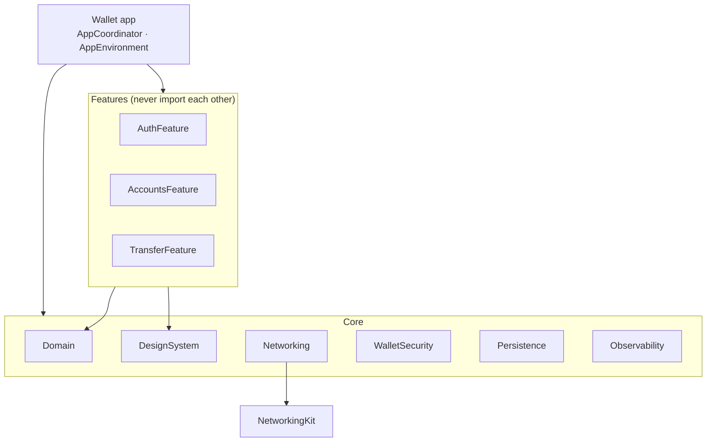
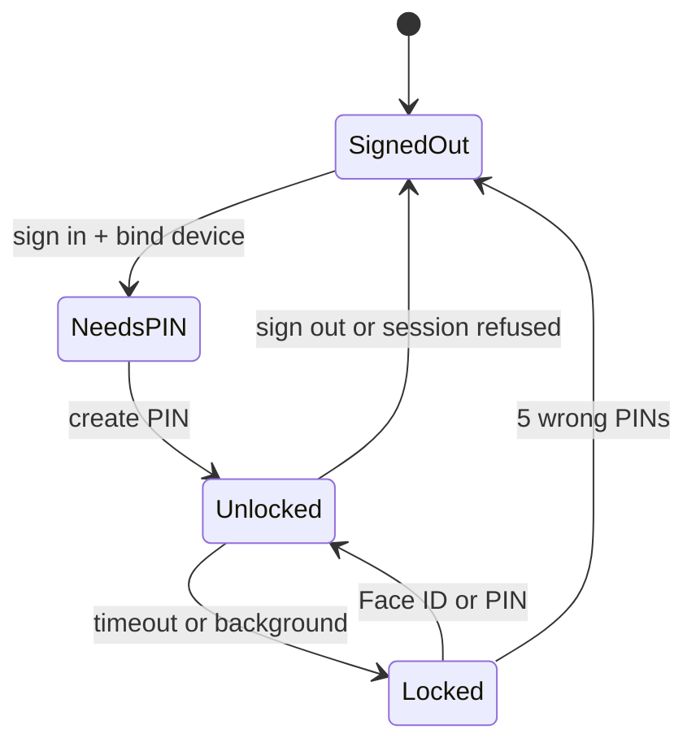
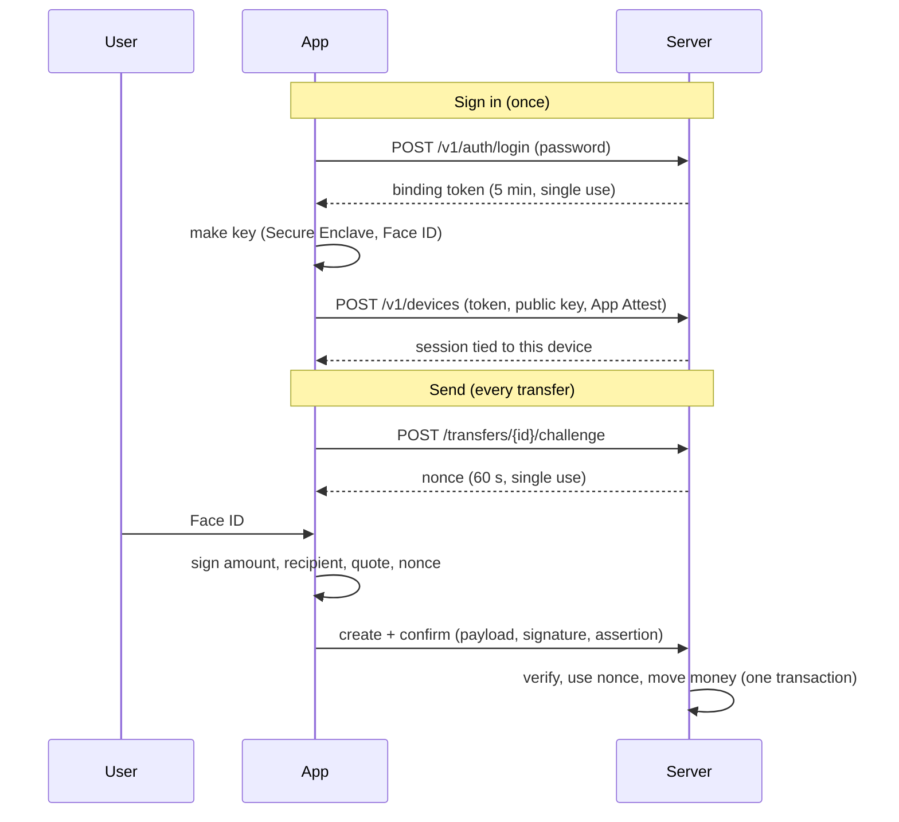

# Wallet

A multi-currency wallet for iOS with a Wise-style send flow and bank-grade security, built as a portfolio project. It uses fake money and a local sandbox backend only.

- **Send money across currencies** with a live FX quote, a fee breakdown, a 30-second rate lock and idempotent transfers that survive the app being killed.
- **Every transfer is signed** by a Secure Enclave key behind Face ID, with a single-use server nonce, so a stolen password or access token can't move money.
- **App Attest, TLS public-key pinning, an app PIN, auto-lock** and a privacy cover in the app switcher.
- **Swift 6 strict concurrency**, SwiftUI, MVVM with one router per flow, and a modular Swift package where the compiler enforces the module boundaries.
- **A Vapor backend in Swift** that verifies signatures, nonces and App Attest for real, not as stubs.

> **Status:** Phases 1–7 of 10 are done: accounts, sign-in, the send flow, the transfer outbox, signing, App Attest and pinning. Still to come: passport reading over NFC (IdentitySDK), production hardening with TestFlight, and portfolio polish. See [Roadmap](#roadmap).

---

## Contents

- [Quick start](#quick-start)
- [Using the app](#using-the-app)
- [Sandbox data](#sandbox-data)
- [Configuration](#configuration)
- [Tests and lint](#tests-and-lint)
- [Project structure](#project-structure)
- [Architecture decisions](#architecture-decisions)
- [Roadmap](#roadmap)

---

## Quick start

### Requirements

- macOS with Xcode 26 (Swift 6 toolchain)
- An iOS 17+ simulator, such as iPhone 16

### 1. Start the backend

```bash
cd backend
ATTEST_MODE=sandbox swift run WalletBackend serve
```

The API runs on `http://127.0.0.1:8080`. The first run creates `backend/wallet-sandbox.sqlite` and fills it with the [sandbox data](#sandbox-data). To start again from fresh data, stop the server and delete that file.

`ATTEST_MODE=sandbox` is needed because the simulator can't produce App Attest. The server won't start until you choose an attestation mode, so the check can't be left off by accident (see [Configuration](#configuration)).

### 2. Run the app

1. Open `Wallet.xcodeproj` in Xcode.
2. Choose the **Wallet** scheme and an iOS simulator.
3. Press **Run** (⌘R).

The Debug build talks to `http://127.0.0.1:8080`. Plain HTTP is allowed for local addresses in Debug builds only (ADR-018).

### 3. Turn on Face ID in the simulator

In the Simulator menu choose **Features → Face ID → Enrolled**. Without it, the app signs in as view only and can't send money (see [Using the app](#using-the-app)).

### No backend? Use the built-in mock

In **Product → Scheme → Edit Scheme → Run → Arguments**, add `-mockServer`. The app then uses an in-memory fake bank, accepts any email (the password `wrong` is refused), and approves transfers without a Face ID prompt. The UI tests run this way.

---

## Using the app

### Sign in

1. Sign in with `demo@wallet.test` / `sandbox-demo`.
2. Behind the scenes the password returns only a short-lived **binding token**. The app then:
   - creates a signing key (in the Secure Enclave on a phone, or a self-generated key on the simulator),
   - registers its public half with the server (`POST /v1/devices`), and
   - only then receives a session.
3. **Create a 6-digit app PIN.** It is checked on the device. After 5 wrong tries the session is wiped and you sign in again.

### Lock and unlock

- The app locks after **5 minutes** of inactivity, or **2 minutes** in the background.
- Unlock with **Face ID** (Simulator: **Features → Face ID → Matching Face**) or your PIN.
- In the app switcher, a privacy cover hides your balances.

### Accounts

- Balances for SGD, USD, JPY and KWD, each shown with its own number of decimal places (JPY 0, KWD 3).
- Tap an account to see its history. More pages load as you scroll, and you can pull to refresh.
- The app keeps no balances on the device. When offline it says so and offers Retry, instead of showing old numbers.

### Send money

1. **Send money** → choose a recipient → enter an amount.
2. **Review** shows the rate, the fee, what the recipient gets, and a 30-second countdown. When it runs out the app fetches a new rate and shows it. It never changes silently.
3. Tap **Send** and approve with Face ID (**Matching Face**). The prompt says what you're approving, for example "Approve sending S$100.00 to Alice Tan".
4. The status screen follows the transfer from Sending to Processing to Completed. The sandbox settles 3 seconds after the confirm.

Things to try:

| Try | What happens |
|---|---|
| Kill the app while it says "Sending", then reopen it | The outbox resumes and finishes the same transfer once. You don't sign again. |
| Double-tap **Send** | Only one transfer is created. |
| Send to **Test: always declined** | The transfer is declined at settlement and refunded. You see the reason. |
| Answer the prompt with **Non-matching Face**, or cancel it | Nothing is sent. You stay on Review. |
| Turn off **Features → Face ID → Enrolled**, turn it on again, then open Send money | "Face ID has changed". **Sign in again** creates a new key for the current faces. |
| Wait on Review until the countdown ends | A new rate is shown before you can send. |

### On a real iPhone

1. Set `WalletAPIBaseURL` in `Config/Wallet-Debug.plist` to your Mac's local network address. The phone can't reach `127.0.0.1`.
2. Sign the app with a paid Apple developer team that has the **App Attest** capability.
3. Start the backend with App Attest checks on:

   ```bash
   APP_ATTEST_APP_ID=<TeamID>.jw.Wallet APP_ATTEST_ENV=development swift run WalletBackend serve
   ```

On a phone the key lives in the Secure Enclave and every binding and transfer carries an App Attest attestation or assertion, which the server verifies against Apple's root certificate.

---

## Sandbox data

All of this is fake seed data, created on the backend's first run.

| | |
|---|---|
| Sign-in | `demo@wallet.test` / `sandbox-demo` |
| Second user (for isolation tests) | `other@wallet.test` / `sandbox-other` |
| Accounts | SGD 12,500.00 · USD 3,200.00 · JPY 150,000 · KWD 120.500 |
| Recipients | Alice Tan (USD) · Kenji Sato (JPY) · Marie Dubois (EUR) · Omar Al-Sabah (KWD) · Test: always declined (EUR) |

The API is described in [`backend/openapi.yaml`](backend/openapi.yaml).

---

## Configuration

### Backend environment variables

| Variable | Default | Purpose |
|---|---|---|
| `ATTEST_MODE` | none | `sandbox` skips App Attest, for the simulator. Either this or `APP_ATTEST_APP_ID` is required. |
| `APP_ATTEST_APP_ID` | none | `<TeamID>.<bundle ID>`. Turns on App Attest checks for real devices. |
| `APP_ATTEST_ENV` | production | `development` also accepts keys from Debug builds. |
| `DATABASE_PATH` | `wallet-sandbox.sqlite` | The SQLite file. |
| `SIMULATION_HEADERS` | off | `on` enables the `X-Sim-Delay` and `X-Sim-Fail` headers for injecting faults. |

### App build settings

| Setting | Where | Notes |
|---|---|---|
| `WalletAPIBaseURL` | `Config/Wallet-Debug.plist`, `Config/Wallet-Release.plist` | The backend URL for each build configuration (ADR-021). |
| `WalletAPIPins` | the same plists | SPKI SHA-256 pins: at least two, the current key and a backup. Empty in Release until a hosted server exists, so Release fails closed. |
| App Attest entitlement | `Config/Wallet-*.entitlements` | `development` in Debug, `production` in Release. |

### Launch arguments (Debug only)

| Argument | Effect |
|---|---|
| `-mockServer` | Use the in-memory fake bank instead of the backend. |
| `-uiTesting` | No artificial delays in the mock. |
| `-simulateOffline` | The mock behaves as if there's no connection. |
| `-signing keyInvalidated` / `-signing biometryNotSetUp` | The mock signer acts like a phone whose Face ID changed, or has none. |
| `-quoteSeconds <n>` | The mock quote's lifetime. |
| `-transferDelay <n>` | How long the mock takes to settle. |
| `-autoLockSeconds <n>` | A shorter auto-lock, for testing. |
| `-resetSession` | Start signed out. |

---

## Tests and lint

```bash
# Swift package with all app modules, plus the import check
cd WalletKit && swift test --explicit-target-dependency-import-check error

# Generic HTTP client
cd NetworkingKit && swift test

# Backend
cd backend && swift test

# App unit tests and UI tests (against the mock)
xcodebuild test -project Wallet.xcodeproj -scheme Wallet \
  -destination 'platform=iOS Simulator,name=iPhone 16'

# Lint, format and module boundaries
swiftlint lint --strict
swift format lint --strict --recursive Wallet WalletTests WalletUITests WalletKit NetworkingKit backend/Sources backend/Tests
scripts/check-module-boundaries.sh
```

`EndToEndUITests` signs in against the real backend. It is skipped unless the backend is running and the credentials are passed in the environment, so none are in source:

```bash
TEST_RUNNER_WALLET_E2E_EMAIL=demo@wallet.test TEST_RUNNER_WALLET_E2E_PASSWORD=sandbox-demo \
  xcodebuild test -project Wallet.xcodeproj -scheme Wallet \
  -destination 'platform=iOS Simulator,name=iPhone 16' \
  -only-testing:WalletUITests/EndToEndUITests
```

GitHub Actions (`.github/workflows/pr.yml`) runs lint, every test suite and the module boundary check on each pull request.

---

## Project structure

```
Wallet/              App target: WalletApp, AppCoordinator, AppEnvironment (the composition root)
WalletKit/           Local Swift package with every module and its tests
  Sources/
    AuthFeature, AccountsFeature, TransferFeature, OnboardingFeature     features
    Domain, DesignSystem, Navigation, Networking,                        core
    WalletSecurity, Persistence, Observability
    IdentitySDK                                                          standalone SDK (Phase 8)
NetworkingKit/       Standalone package: generic HTTP client and interceptors
backend/             Vapor service, SQLite, openapi.yaml
docs/                SPEC.md and the ADRs in docs/adr/
contracts/           Data shared by the app and backend tests (currency table)
```



---

## Architecture decisions

Each decision is recorded as an ADR in [`docs/adr/`](docs/adr), with the alternatives that were rejected and why. The full design is in [`docs/SPEC.md`](docs/SPEC.md).

### Modules and boundaries

- **Local Swift package modules, and features never import each other** ([ADR-004](docs/adr/004-local-spm-modules.md)). Features see only protocols in `Domain`. The real implementations (`Networking`, `WalletSecurity`, `Persistence`) are injected by the app. A forbidden import fails to compile, and a CI script double-checks it.
- **A standalone `NetworkingKit` package** ([ADR-012](docs/adr/012-custom-urlsession-client.md)). It's a generic `URLSession` client with an interceptor chain (auth, idempotency key, retry with backoff, request ID) and knows nothing about the wallet.
- **A plain Xcode project with a local package** ([ADR-013](docs/adr/013-plain-xcode-and-local-spm.md)). The project holds only the app target. Tuist is the option at team scale.
- **Manual constructor injection** ([ADR-005](docs/adr/005-manual-constructor-injection.md)). `AppEnvironment` builds every dependency once and passes it down through initialisers. There are no singletons and no service locator. Previews and tests pass fakes the same way.
- **Swift 6 strict concurrency everywhere** ([ADR-014](docs/adr/014-swift-6-strict-concurrency.md)). UI types are `@MainActor`, and shared state (`SessionStore`, `TransferOutbox`) lives in actors.

### Navigation

- **MVVM with one router per flow.** Each feature has a `Route` enum, an `@Observable` router that owns a `NavigationPath`, and a single public `FlowView`. Views render state and never navigate except through the router.
- **Cross-feature navigation goes through output closures.** For example, Accounts calls `onSendMoney`, and `AppCoordinator` decides what happens next, so features stay independent.
- **The root screen is swapped from the session state, never pushed** ([ADR-020](docs/adr/020-root-swap-by-session-state.md)). Signed out, set a PIN, locked and unlocked are separate roots, so there is no "back" past the lock screen.



### Data and transfers

- **No account data cached on the device** ([ADR-017](docs/adr/017-no-offline-account-cache.md)). Balances are always fresh or clearly unavailable. Nothing to leak from a seized phone.
- **A SwiftData transfer outbox with `.complete` file protection** ([ADR-009](docs/adr/009-swiftdata-outbox-complete-protection.md)). Each transfer step is saved before the network call. The file is unreadable while the phone is locked and is deleted at sign-out.
- **The recovery rule** ([ADR-022](docs/adr/022-unsigned-confirm-and-outbox-recovery.md)). On relaunch the outbox resumes every unfinished transfer, and every call is safe to repeat because it's keyed on the transfer ID. A timeout is never treated as a failure: the app asks the server again.
- **Money is `Decimal`**, never `Double`, with integer minor units at the API boundary. The app re-checks the server's quote maths (`FXQuote.addsUp`) before showing it.

### Sign-in and device security

- **An app PIN checked on the device** ([ADR-019](docs/adr/019-app-pin-checked-on-device.md)). A salted PBKDF2 hash in the Keychain, 5 attempts, then the session is wiped. A Face ID enrolment change requires the PIN before Face ID is trusted again.
- **Device binding at every sign-in** ([ADR-008](docs/adr/008-secure-enclave-transaction-signing.md)). The password alone gets only a single-use binding token. A session exists only after the device has registered its signing key.
- **Each transfer is signed with a Secure Enclave key** ([ADR-008](docs/adr/008-secure-enclave-transaction-signing.md)). The key requires the *current* Face ID enrolment (`.biometryCurrentSet`). The server checks the signature, compares every signed field with the stored transfer, and uses up a 60-second single-use nonce in the same database transaction that moves the money.
- **Signing happens at the Send tap; the simulator uses a self-generated key** ([ADR-023](docs/adr/023-sign-at-send-and-simulator-signing.md)). Face ID can only be asked for while the user is looking, so the outbox keeps the signed approval and resends it after a crash without prompting. The simulator has no Secure Enclave, so it generates its own key behind the same Face ID rules. There is no fixed key in the source.
- **App Attest verified on the server** ([ADR-024](docs/adr/024-app-attest-verification.md)). The server checks the attestation chain to Apple's root certificate, the app ID, the key ID and the assertion counter, using Apple's swift-certificates and a small strict CBOR decoder.
- **TLS public-key pinning with a backup pin** ([ADR-006](docs/adr/006-tls-public-key-pinning.md)). At least two pins are required. A malformed pin list fails closed, and a pin failure is reported as such, never as a cancel.
- **Plain HTTP only to local addresses, and only in Debug** ([ADR-018](docs/adr/018-debug-only-local-networking.md)), with the backend URL set per build configuration ([ADR-021](docs/adr/021-backend-url-per-build-configuration.md)).



### Backend

- **A sandbox backend that does the real checks** ([ADR-016](docs/adr/016-sandbox-backend-design.md)). SQLKit rows, hashed rotating refresh tokens, and two-layer idempotency (the key plus a comparison of the request body).

---

## Roadmap

| Phase | Scope | Status |
|---|---|---|
| 1–3 | Repo skeleton, Domain and design system, backend and networking | Done |
| 4 | Accounts (online only) | Done |
| 5 | Sign-in, PIN, Face ID, auto-lock | Done |
| 6 | Send flow and transfer outbox | Done |
| 7 | Secure Enclave signing, App Attest, TLS pinning | Done |
| 8 | IdentitySDK: reading a passport chip over NFC (BAC/PACE, DG1/DG2, passive authentication) | Planned |
| 9 | Sentry with scrubbing, screen-recording masking, a remote kill switch, TestFlight through Fastlane | Planned |
| 10 | Case-study write-up, threat model, demo video | Planned |

Known gaps: there is no step-up check when a new device binds, so a phished password could bind another phone. Release builds have no pins until a hosted server exists. Jailbreak signals (ADR-007) aren't built yet.
