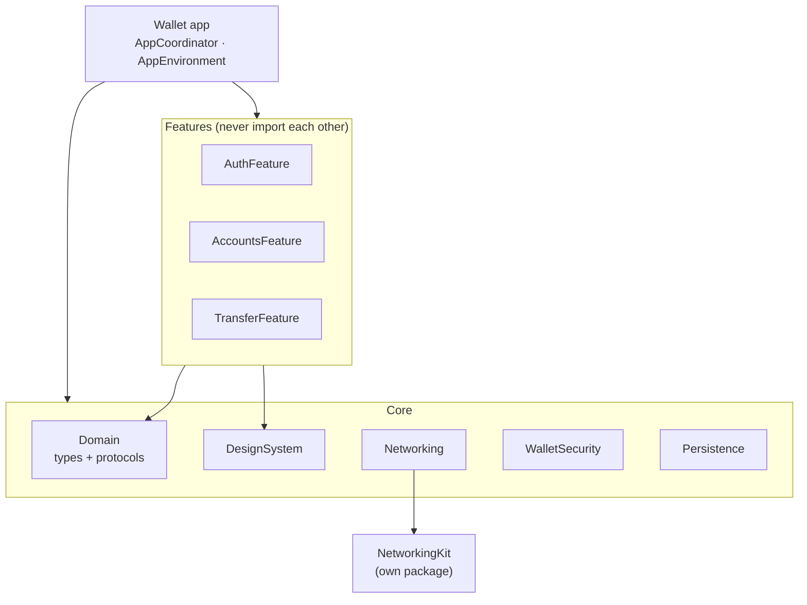
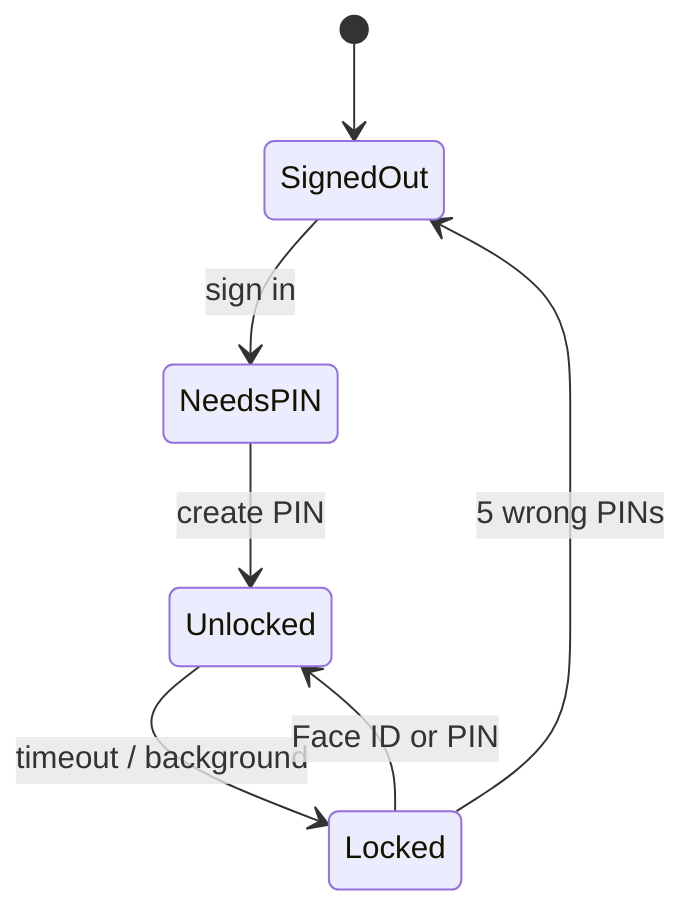
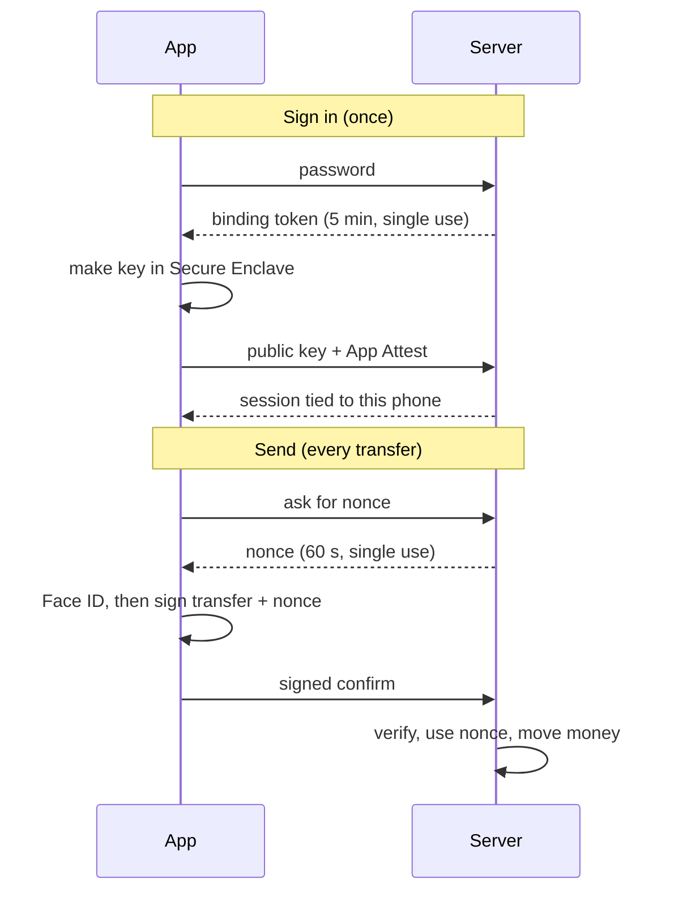

# Wallet

A multi-currency wallet for iOS with a Wise-style send flow and bank-grade security.
Fake money and a local sandbox backend, but **real** security: Secure Enclave signing, App Attest and TLS pinning.

**Swift 6 · SwiftUI · Swift Package modules · CryptoKit · App Attest · SwiftData · Vapor · Swift Testing · XCUITest · GitHub Actions**

> **Status:** Phases 1–7 of 10 done.
> **Run it:** [Quick start](#quick-start) · Full guide: [docs/DEVELOPMENT.md](docs/DEVELOPMENT.md)

---

## Highlights

- 💱 **Send money across currencies:** live FX quote, fee breakdown, 30-second rate lock
- 🔁 **Each transfer happens exactly once:** safe against double taps, timeouts and the app being killed
- 🔐 **A password alone can't move money:** every transfer is signed by a Secure Enclave key behind Face ID
- 📱 **Only the genuine app on a real iPhone:** App Attest, verified by our own server
- 🧱 **Module rules checked by the compiler:** a feature that imports another feature doesn't build
- ✅ **500+ automated tests,** run in CI on every pull request

---

## Architecture



| Decision | Why | Instead of |
|---|---|---|
| **Modules in a local Swift package** ([ADR-004](docs/adr/004-local-spm-modules.md)) | A forbidden import **fails to compile**. Modules test on their own, with no simulator. | Folders in one target, where the rules are only a convention |
| **Features only see `Domain` protocols** | Features can't reach networking or security code directly. Easy to fake in tests. | Features calling the API client directly |
| **Plain Xcode project + package** ([ADR-013](docs/adr/013-plain-xcode-and-local-spm.md)) | Simple for one developer. SwiftPM already enforces the modules. | Tuist or XcodeGen, worth it at team scale |
| **Manual dependency injection** ([ADR-005](docs/adr/005-manual-constructor-injection.md)) | A missing dependency is a compile error. No hidden global state. | Singletons, or DI frameworks like Factory |
| **Own networking layer** ([ADR-012](docs/adr/012-custom-urlsession-client.md)) | About 300 lines over URLSession. No third-party code in the most sensitive path. | Alamofire |
| **Swift 6 strict concurrency** ([ADR-014](docs/adr/014-swift-6-strict-concurrency.md)) | Data races in session and transfer code caught at compile time. | Swift 5 mode in some modules |

---

## Navigation



| Decision | Why | Instead of |
|---|---|---|
| **MVVM with one router per flow** | Navigation is testable without UI. Views have no logic. | Navigation inside views, or TCA (large dependency) |
| **Features talk through output closures** | Features stay independent. The app flow lives in one place (`AppCoordinator`). | Features opening each other's screens |
| **Root screen swapped by session state** ([ADR-020](docs/adr/020-root-swap-by-session-state.md)) | No "back" past the lock screen. Balances aren't even loaded behind it. | One navigation stack, or the lock screen as a cover |

---

## Money and transfers

- **Money is `Decimal`,** never `Double`. Each currency rounds to its own decimals (JPY 0, SGD 2, KWD 3).
- **The API uses integer minor units,** for example `125000` for SGD 1,250.00.
- **The app re-checks the server's quote maths** before showing it.
- **The transfer state machine is a pure function,** with every state change tested.

| Decision | Why | Instead of |
|---|---|---|
| **Outbox saves each step before the network call** ([ADR-009](docs/adr/009-swiftdata-outbox-complete-protection.md)) | A killed app resumes the transfer on relaunch. | Keeping state in memory only |
| **A timeout is never a failure** ([ADR-022](docs/adr/022-unsigned-confirm-and-outbox-recovery.md)) | The server may have done the work. Ask for the status instead, so the user never pays twice. | Showing "failed" and letting the user retry |
| **Every call keyed by transfer ID + `Idempotency-Key`** | Repeating a call is always safe. | Hoping the network doesn't fail |
| **Outbox file uses `.complete` protection** | Unreadable while the phone is locked. Deleted at sign-out. | GRDB with SQLCipher, two more dependencies |
| **No balances cached on the device** ([ADR-017](docs/adr/017-no-offline-account-cache.md)) | No stale balances, and nothing to leak from a seized phone. | An offline cache of balances |

---

## Security



| Decision | Stops | Instead of |
|---|---|---|
| **Device binding:** the password only gets a 5-minute ticket; a session needs a registered device key ([ADR-008](docs/adr/008-secure-enclave-transaction-signing.md)) | A stolen password becoming a session | Login returning a session directly |
| **Secure Enclave signing:** each transfer signed after Face ID; key tied to the current faces ([ADR-008](docs/adr/008-secure-enclave-transaction-signing.md)) | A stolen session token moving money. A newly added face approving transfers. | A Face ID check in the app only, which the server can't verify |
| **Server checks every signed field + a single-use nonce,** in the same transaction that moves the money | Changed amounts and replayed requests | Trusting the request body |
| **Sign at the Send tap** ([ADR-023](docs/adr/023-sign-at-send-and-simulator-signing.md)) | Face ID prompts with no context after a crash | Signing in the background outbox |
| **Simulator generates its own key** ([ADR-023](docs/adr/023-sign-at-send-and-simulator-signing.md)) | A secret in the source code | A fixed demo key |
| **App Attest verified on our server** ([ADR-024](docs/adr/024-app-attest-verification.md)) | Modified apps and scripts calling the API | A third-party package, or DeviceCheck alone |
| **TLS public-key pinning + backup pin** ([ADR-006](docs/adr/006-tls-public-key-pinning.md)) | Man-in-the-middle with a fake root certificate | Trusting any certificate the phone trusts |
| **App PIN checked on device:** PBKDF2 hash in Keychain, 5 tries ([ADR-019](docs/adr/019-app-pin-checked-on-device.md)) | Anyone who knows the phone passcode | Falling back to the phone passcode |

**Also:**
- **Auto-lock:** after 5 minutes of inactivity, or 2 minutes in the background.
- **A privacy cover** in the app switcher.
- **Server-side revoke** at sign-out.
- **No personal data in logs.** `print` is banned by lint.
- **HTTP to local addresses only in Debug** ([ADR-018](docs/adr/018-debug-only-local-networking.md)).

---

## Backend

A small Vapor service in Swift that does the **real** checks ([ADR-016](docs/adr/016-sandbox-backend-design.md)).

- **Verifies** signatures, nonces and App Attest itself.
- **Plain SQL rows,** so it needs no exceptions to the concurrency rules.
- **Opaque, hashed, rotating refresh tokens:** revoking one takes effect immediately, unlike a JWT.
- **Two layers of idempotency:** the key record, plus the permanent transfer ID.

---

## Testing

| Suite | Tests | Highlights |
|---|---|---|
| WalletKit | 310 | Money rounding, every state change, outbox, signing |
| Backend | 102 | Tampered amount, reused and expired nonce, another device's key |
| NetworkingKit | 47 | Retry, idempotency, token refresh, pinning |
| App + UI | 54 | Sign in, send, quote expiry, offline, Face ID changed, kill and resume |

**Do the tests actually catch bugs?** I turned off the server's signature and amount checks on purpose. 7 backend tests failed, including the one where an attacker changes the amount, so the tests really protect the money. (This is called mutation testing.)

---

## Build log

| Phase | Built |
|---|---|
| 1 | Project skeleton, modules, lint, CI |
| 2 | Money, FX, transfer state machine, design system |
| 3 | Networking layer, Vapor backend |
| 4 | Accounts: balances, history, offline state |
| 5 | Sign-in, PIN, Face ID, auto-lock |
| 6 | Send flow, crash-safe outbox |
| 7 | Device binding, Secure Enclave signing, App Attest, pinning |

---

## Quick start

```bash
cd backend && ATTEST_MODE=sandbox swift run WalletBackend serve
```

1. Open `Wallet.xcodeproj` and run the **Wallet** scheme on an iOS 17+ simulator.
2. In the Simulator menu, turn on **Features → Face ID → Enrolled**. When sending money, choose **Features → Face ID → Matching Face**.
3. Sign in with `demo@wallet.test` / `sandbox-demo`.

More in the [development guide](docs/DEVELOPMENT.md). Every decision, with its alternatives, is in [`docs/adr/`](docs/adr).
