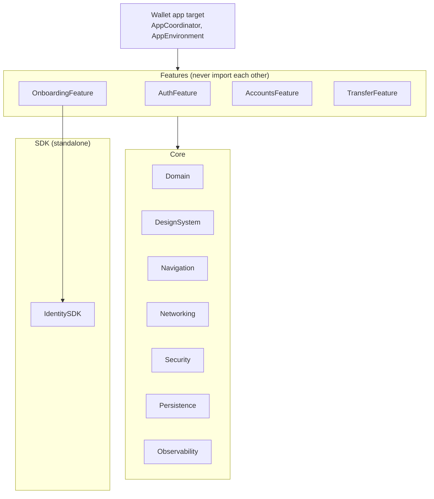
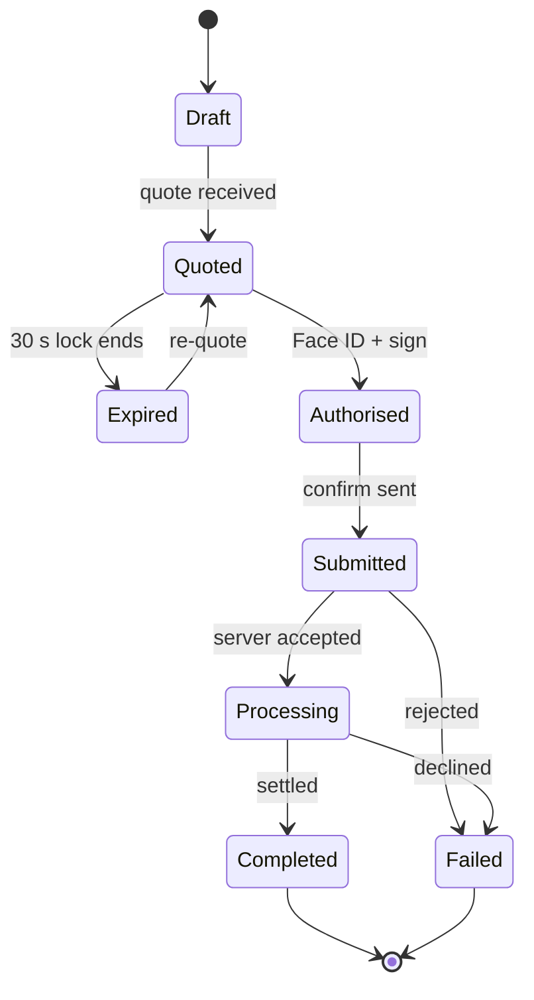

# Wallet iOS — Project Spec

Multi-currency wallet app for iOS with bank-grade security. Senior-level portfolio piece targeting DBS, Wise and Thales. Fake money and sandbox services only.

**Out of scope:** real money movement, real bank integrations, Android, a production-grade backend. The backend exists only to make the security flows real end to end.

## 1. Goals by company

| Company | What they look for | Features that prove it |
| --- | --- | --- |
| DBS | Security at scale, big-team engineering, accessibility | Modular SPM, threat model, device binding, CI |
| Wise | Correct FX and fees, honest UX, ownership | Send flow with live quote, fee breakdown, rate lock, idempotent transfers |
| Thales | Cryptography, device security, digital identity, SDK design | Secure Enclave signing, App Attest, NFC passport eKYC as a documented SDK |

## 2. Tech stack

| Area | Decision | Notes |
| --- | --- | --- |
| Language | Swift 6, strict concurrency in every module | No `@unchecked Sendable` without an ADR |
| Min iOS | iOS 17 | `@Observable`, SwiftData, Swift Charts |
| UI | SwiftUI-first | UIKit only behind wrappers (NFC, camera, screenshot masking) |
| Architecture | MVVM + Coordinators | `@Observable` view models; no navigation logic in views |
| Navigation | One `@Observable` router per flow owning a `NavigationPath` | App coordinator composes the flows |
| Modularization | Local SPM package with App / Features / Core / SDK layers | Features never import features |
| Project | Plain Xcode project + local `Package.swift` | Tuist noted in ADR-013 as the team-scale option |
| Design system | Own `DesignSystem` package: tokens + components | Every component has previews |
| Persistence | SwiftData cache with `.complete` file protection | Secrets in Keychain only |
| Networking | Custom `URLSession` client, async/await | Interceptors: auth, idempotency, signing, retry, pinning |
| Backend | Vapor (Swift) + Fluent SQLite | FX quotes, transfers, signature verification |
| DI | Manual constructor injection | Wired in the App composition root |
| Unit tests | Swift Testing | Domain, view models, networking, security |
| UI tests | XCUITest | Login and transfer flows |
| CI/CD | GitHub Actions + Fastlane | Lint + test on PR; TestFlight on tag |
| Lint | SwiftLint + swift-format | Enforced in CI |
| Observability | OSLog with privacy redaction + Sentry | No PII in logs or crashes |
| Languages | English, Simplified Chinese | RTL-safe layouts |
| Docs | DocC for SDK and Core | ADRs in `docs/adr/` |

## 3. Module structure



### Folder layout

```
Wallet/                      Xcode project (app target only)
  WalletApp.swift
  AppCoordinator.swift
  AppEnvironment.swift       composition root, builds every dependency
WalletKit/
  Package.swift
  Sources/
    AuthFeature/  OnboardingFeature/  AccountsFeature/  TransferFeature/
    Domain/  DesignSystem/  Navigation/  Networking/  Security/
    Persistence/  Observability/  IdentitySDK/
  Tests/                     one test target per module
backend/                     Vapor service + openapi.yaml
docs/
  SPEC.md  adr/  threat-model.md
.github/workflows/
fastlane/
```

### Dependency rules

| Module | May import | Must not import |
| --- | --- | --- |
| Any Feature | Core modules it needs | Any other Feature |
| OnboardingFeature | Core + IdentitySDK | Other Features |
| Domain | Foundation only | Everything else |
| DesignSystem | SwiftUI + Domain | Features, Networking, Security |
| Networking, Security, Persistence | Domain, Observability | Features, DesignSystem |
| Observability | Foundation, OSLog, Sentry | Everything in WalletKit |
| IdentitySDK | Apple frameworks only (CoreNFC, CryptoKit) | Anything in WalletKit |

Enforced by `Package.swift` target dependencies, so a forbidden import fails to compile.

## 4. Architecture

**Layers inside a feature**
- **View** (SwiftUI): renders state, forwards actions. No business logic; navigates only through the router.
- **ViewModel** (`@Observable`, `@MainActor`): one `State` value, calls use cases, maps errors to `UserFacingError`.
- **Use case / Repository**: protocols in Domain, implementations in Core. Async, `Sendable`.
- **Router** (`@Observable`, one per flow): owns `NavigationPath` plus sheet and full-screen-cover state.

**Navigation**
- Each feature defines a `Route` enum (`Hashable`) and a `Router` with `push`, `pop`, `popToRoot`, `present`, `dismiss`.
- Each feature exposes one public entry view, e.g. `TransferFlowView(router:dependencies:onFinish:)`.
- Cross-feature navigation is an output closure (e.g. Accounts calls `onSendMoney(accountID)`); `AppCoordinator` decides.
- Deep links (`wallet://transfer?to=...`) are parsed in `Navigation` into an `AppRoute`, handled by `AppCoordinator`.
- Sensitive flows re-authenticate before the route is pushed.

**Dependency injection**
- Each feature declares a `Dependencies` struct of protocols.
- `AppEnvironment` builds concrete implementations once and passes them down through initialisers.
- Previews and tests pass mocks. No singletons, no service locator.

**Concurrency**
- Swift 6 language mode, complete strict concurrency everywhere.
- UI types are `@MainActor`. Shared mutable state lives in actors: `SessionStore`, `BalanceStore`, `TransferOutbox`.
- Domain models are `Sendable` value types. Leaving a screen cancels its `.task {}` work.

**App lifecycle**
- Background → blur overlay over the window (no balances in the app switcher).
- Inactive 5 minutes, or 2 minutes in background → session locks, requires Face ID or PIN.
- Launch → integrity signal, restore session, resume pending transfers from the outbox.

## 5. Domain model

**Core types**
- `Currency`: ISO 4217 code + `minorUnits` (SGD 2, JPY 0, KWD 3).
- `Money`: `amount: Decimal` + `currency`. Arithmetic only between equal currencies (throws otherwise). Banker's rounding to minor units. Converts to/from `amountMinor: Int64`. Provides `formatted(locale:)` and `accessibilityLabel`.
- `FXQuote`: `id`, `sourceAmount`, `targetAmount`, `rate`, `fee`, `expiresAt`.
- `Transfer`: `id` (client UUID, also the idempotency key), `quote`, `recipient`, `state`, `createdAt`, `updatedAt`.

**Transfer state machine**



| State | Entered when | User sees |
| --- | --- | --- |
| Draft | Recipient and amount chosen | Amount screen |
| Quoted | Server returns an FX quote | Rate, fee, receive amount, 30 s countdown |
| Expired | Quote lock passes before confirm | "Rate updated" and the new quote, never a silent change |
| Authorised | Face ID passes and payload is signed | Brief "confirming" state |
| Submitted | Signed confirm request sent | Spinner; safe to leave the app |
| Processing | Server accepted, settlement pending | "On its way" with estimated arrival |
| Completed | Server reports settled | Success screen and receipt |
| Failed | Server rejects or declines | Clear reason and next step, balance unchanged |

**Rules**
- Transitions are a pure function `next(state, event) -> State` in Domain, tested for every valid and invalid pair.
- Every transition is written to the `TransferOutbox` actor (SwiftData-backed) before the network call.
- On launch, the outbox resumes Submitted/Processing transfers by polling `GET /v1/transfers/{id}`. A timeout is never treated as Failed.

## 6. Security design

**Device binding (first login)**
1. Sandbox login (email + password) returns a short-lived binding token.
2. App generates a P-256 key in the Secure Enclave with access control `.biometryCurrentSet` + `.privateKeyUsage`.
3. App runs App Attest and sends public key, attestation object and device ID to `POST /v1/devices`.
4. Server verifies attestation and stores the public key against user + device.

**Transaction signing (every transfer)**
1. `POST /v1/transfers/{id}/challenge` returns a single-use nonce valid 60 s.
2. App builds a canonical payload: transfer ID, amountMinor, currency, recipient ID, quote ID, nonce, timestamp (sorted-key JSON, no whitespace).
3. Face ID unlocks the key; app signs SHA-256 of the payload with ECDSA.
4. App sends payload + signature to `POST /v1/transfers/{id}/confirm`.
5. Server verifies signature, nonce freshness and single use, and that the payload matches the stored transfer.

Biometric enrolment change invalidates the key (`.biometryCurrentSet`); the user must re-bind. Explain this in the UI.

**Storage**
- Keychain (`kSecAttrAccessibleWhenUnlockedThisDeviceOnly`): access token, refresh token, device ID.
- Secure Enclave: signing private key, never exported.
- SwiftData: `.complete` file protection; cached balances and transactions only.
- Never: UserDefaults for sensitive data, secrets in source, PII in logs.

**Network**
- TLS public-key pinning (SPKI hash) with a backup pin (ADR-006).
- `Idempotency-Key` on every mutating call; request ID on every call.
- 401 → one token refresh, then lock the session.

**Integrity**
- App Attest assertions on device binding and transfer confirm.
- Jailbreak heuristics are a risk signal sent to the server, not a hard block (ADR-007).
- Screenshot / screen-recording masking on balance, transfer review and PIN screens.
- Secure entry for PIN; `.oneTimeCode` content type for OTP.

**Threat model summary** (full version: `docs/threat-model.md`)

| Threat | Example | Mitigation |
| --- | --- | --- |
| Stolen unlocked phone | Thief opens the app | Session lock, Face ID re-auth on every transfer |
| Man in the middle | Proxy on public Wi-Fi | TLS pinning, signed payloads |
| Replay | Captured confirm resent | Single-use nonce, 60 s expiry, idempotency key |
| Tampered app | Repackaged binary calling the API | App Attest on binding and confirm |
| Remote-access / overlay scam | Scammer guides a victim | Screen-recording detection, cooling-off for new payees, warning copy |
| Data leak | Account number in a crash report | OSLog `.private`, Sentry scrubbing, `print` banned |
| Biometric change | Attacker adds a fingerprint | Key invalidated; re-binding required |

## 7. Backend API (Vapor)

Small Vapor service in `backend/`, Fluent SQLite, seeded fake accounts, simulated FX rates. `backend/openapi.yaml` is the source of truth.

| Method | Path | Purpose | Notes |
| --- | --- | --- | --- |
| POST | `/v1/auth/login` | Sandbox login | Binding token or session tokens |
| POST | `/v1/auth/refresh` | Refresh access token | Rotates refresh token |
| POST | `/v1/devices` | Bind device | Public key + attestation |
| GET | `/v1/accounts` | Balances per currency | Minor units |
| GET | `/v1/accounts/{id}/transactions` | History | Cursor pagination |
| GET | `/v1/recipients` | Saved payees | |
| POST | `/v1/quotes` | FX quote | Rate, fee, receive amount, `expiresAt` (30 s) |
| POST | `/v1/transfers` | Create from quote | Requires `Idempotency-Key` |
| POST | `/v1/transfers/{id}/challenge` | Signing nonce | Single use, 60 s |
| POST | `/v1/transfers/{id}/confirm` | Signed payload | Verifies signature + assertion |
| GET | `/v1/transfers/{id}` | Status | Polled while pending |

**Conventions**
- Money: `{ "amountMinor": 125000, "currency": "SGD" }`. Never floats.
- Errors: `{ "code": "quote_expired", "message": "...", "requestId": "..." }`.
- Same `Idempotency-Key` returns the original response.
- Simulation headers: `X-Sim-Delay: <ms>`, `X-Sim-Fail: network|server|declined`.

## 8. Testing, CI/CD, observability

| Layer | Tool | What to cover | Target |
| --- | --- | --- | --- |
| Domain | Swift Testing | Money rounding, FX, every state transition | 90%+ |
| View models | Swift Testing | State per action, error mapping, cancellation | 80%+ |
| Networking | Swift Testing + `URLProtocol` stub | Interceptors, retry, idempotency reuse, 401 refresh | 80%+ |
| Security | Swift Testing | Canonical payload, sign/verify round trip (software key), Keychain | 80%+ |
| Backend | XCTVapor | Signature verification, nonce reuse, idempotency, quote expiry | 80%+ |
| UI flows | XCUITest | Login → balance; send → confirm → success; quote expired; network failure mid-transfer | Key flows |

UI tests use launch arguments `-uiTesting -mockServer` for a deterministic mock.

**CI/CD**
1. `pr.yml`: SwiftLint, swift-format lint, `swift test`, `fastlane test`, backend tests.
2. Coverage summary on the PR.
3. `release.yml` on `v*` tag: `fastlane beta` (match signing) → TestFlight.
4. Fail if app size grows >10% without a label.

## 9. ADRs

Template: `docs/adr/000-template.md`.

| ADR | Decision | Main alternative rejected |
| --- | --- | --- |
| 001 | SwiftUI-first, UIKit only behind wrappers | UIKit coordinators hosting SwiftUI |
| 002 | MVVM + Coordinators with `@Observable` | TCA |
| 003 | One router per flow owning `NavigationPath` | Navigation inside views |
| 004 | Local SPM modules; features never import features | Single target with folders |
| 005 | Manual constructor injection | swift-dependencies, Factory |
| 006 | TLS public-key pinning with backup pin | Certificate pinning, none |
| 007 | Jailbreak detection as risk signal | Blocking the app |
| 008 | Secure Enclave signing with `.biometryCurrentSet` | Biometric gate + bearer token only |
| 009 | SwiftData with `.complete` file protection | GRDB + SQLCipher |
| 010 | Money as `Decimal`, minor units at API boundary | `Double`, integer-only in app |
| 011 | Transfer state machine with persisted outbox | Ad-hoc flags |
| 012 | Custom `URLSession` client with interceptors | Alamofire |
| 013 | Plain Xcode + local SPM; Tuist at team scale | Tuist from day one |
| 014 | Swift 6 strict concurrency everywhere | Swift 5 mode in some modules |
| 015 | OSLog + Sentry with scrubbing | Firebase Crashlytics |

## 10. Build plan (10 weeks)

Run each phase with `/phase <n>`. Review every diff before committing.

### Phase 1 (week 1): Repo skeleton
- Task: Create Xcode app project `Wallet` (iOS 17) and local package `WalletKit` with every module from section 3. Each module gets a placeholder type and one passing test. Add `.swiftlint.yml`, `.swift-format`, and `.github/workflows/pr.yml`.
- Done when: app builds and launches; `swift test` passes; CI green on a PR; importing one feature into another fails to build.

### Phase 2 (week 2): Domain + design system
- Task: `Money`, `Currency`, `FXRate`, transfer state machine in Domain with full tests. DesignSystem tokens and components: `AmountText`, `AmountField`, `PrimaryButton`, `TransactionRow`, `PINPad`, with previews.
- Done when: rounding tests cover JPY (0), SGD (2), KWD (3); every state transition pair tested; components preview in dark mode and largest Dynamic Type.

### Phase 3 (week 3): Backend + networking
- Task: Vapor backend per section 7 with seed data and simulation headers. `Networking`: `APIClient`, interceptor chain (auth, idempotency, retry with backoff, request ID), DTOs.
- Done when: backend tests pass; a retried POST reuses the same idempotency key.

### Phase 4 (week 4): Accounts + offline cache
- Task: AccountsFeature (balances per currency, paginated history, pull to refresh). Persistence with SwiftData and `.complete` protection; offline balances with "last updated".
- Done when: airplane mode still shows cached balances; VoiceOver reads amounts with currency.

### Phase 5 (week 5): Auth + session
- Task: AuthFeature and `KeychainStore`: sandbox login, Face ID with PIN fallback, token refresh, inactivity auto-lock, background blur.
- Done when: tokens only in Keychain; app locks after timeout; app switcher shows no balances.

### Phase 6 (week 6): Transfer flow + outbox
- Task: TransferFeature: recipient → amount → live quote with fee breakdown and 30 s countdown → review → confirm → result. `TransferOutbox` actor resuming on launch.
- Done when: double-tap Send creates one transfer; expiry re-quotes visibly; killing the app mid-transfer resumes on relaunch.

### Phase 7 (week 7): Secure Enclave signing + App Attest
- Task: Device binding and transaction signing per section 6 on iOS and backend. Public-key pinning with backup pin.
- Done when: backend rejects tampered amount, reused nonce, expired nonce; changing Face ID enrolment forces re-binding.

### Phase 8 (week 8): IdentitySDK
- Task: Standalone package: MRZ input, BAC/PACE, read DG1 + DG2, passive authentication. Async public API, typed errors, DocC tutorial, sample app. Wire into OnboardingFeature.
- Done when: a real passport reads on device; SDK builds alone; DocC builds without warnings.

### Phase 9 (week 9): Production hardening
- Task: Sentry with scrubbing, per-module loggers, screen-recording masking, feature flags with remote kill switch for transfers, Simplified Chinese, XCUITest flows, `release.yml` + Fastlane → TestFlight.
- Done when: a tag produces a TestFlight build; UI tests pass in CI; no PII in a forced test crash.

### Phase 10 (week 10): Portfolio polish
- Task: README as case study (problem, architecture diagram, security decisions linking ADRs, tradeoffs, changes at scale). Draft `docs/threat-model.md`.
- Done when: 90-second demo recorded; TestFlight link public; README reviewed; first blog post drafted by the owner.
